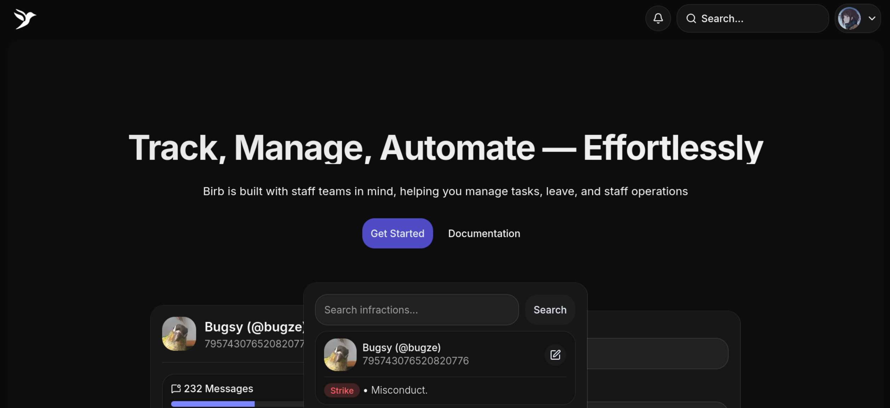
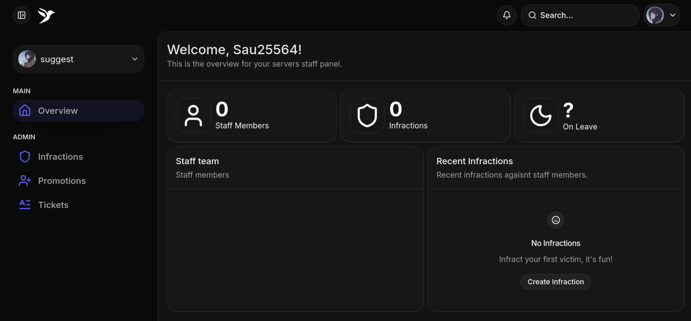
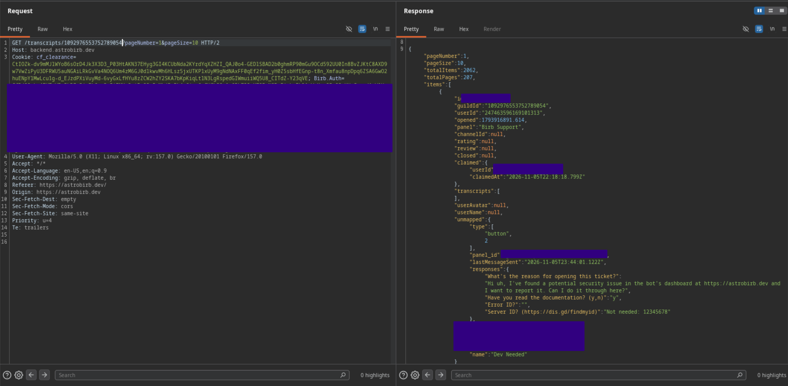

<!-- P2 -->
## Watching the chats of your birds
*Fixed on: 6/11/2026*

[Website](https://astrobirb.dev) | [Discord](https://discord.gg/DhWdgfh3hN)

This is a small bot that focuses on staff management things. It allows you to manage promotions, infractions, and it has a module for support tickets.



There's a dashboard which, at the time of this finding, was only for reading infractions, promotions, tickets stats and transcripts:



I noticed that the dashboard fetches data from the API at `https://backend.astrobirb.dev`. To get infractions, for example, a `GET` request is issued to `/infractions/[guild_id]/1/10?voided=false`, which answers with this on my guild:

```http
HTTP/1.1 200 OK
Access-Control-Allow-Credentials: true
Access-Control-Allow-Origin: https://astrobirb.dev
Alt-Svc: h3=":443"; ma=2592000
Content-Type: application/json; charset=utf-8
Date: Tue, 10 Nov 2026 16:27:13 GMT
Server: Kestrel

{"items":[],"pageNumber":1,"pageSize":10,"totalCount":0,"totalPages":0}
```

I tried changing `[guild_id]` to another guild where I didn't have admin permissions and recently added the bot... and it showed this same response instead of a `403 Forbidden`!

I also saw that the tickets dashboard page also shows open/closed tickets with their ID and transcripts (with image/files attachments). This is retrieved from a `GET` to the `/transcripts/[guild_id]?pageNumber=<System.Integer>&pageSize=<System.Integer>` API endpoint. To do a quick test, I targeted Birb's own support server. On the first attempt it threw a `500 Internal Server Error` but it was just because I wasn't a member of the support server. After joining, I got a `200 OK` with the listing of their tickets:



> That's the ticket where I was reporting this issue.

Wondering what access controls the dev actually put on this dashboard, I noticed that the only permission "check" was at the frontend level. Accessing `https://astrobirb.dev/admin/[guild_id]/` directly returns a redirect to the homepage if you don't have permissions to manage the server. Seems he forgot that the API and frontend were completely different things.

The dev fixed it quickly.