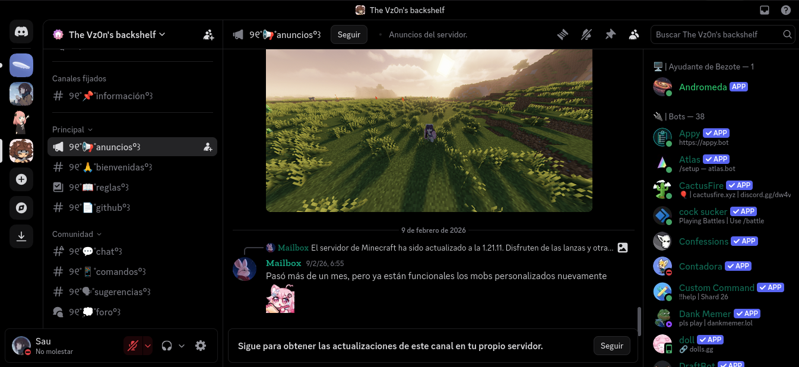
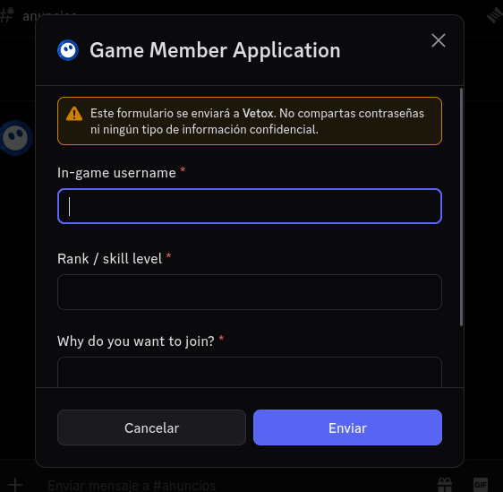
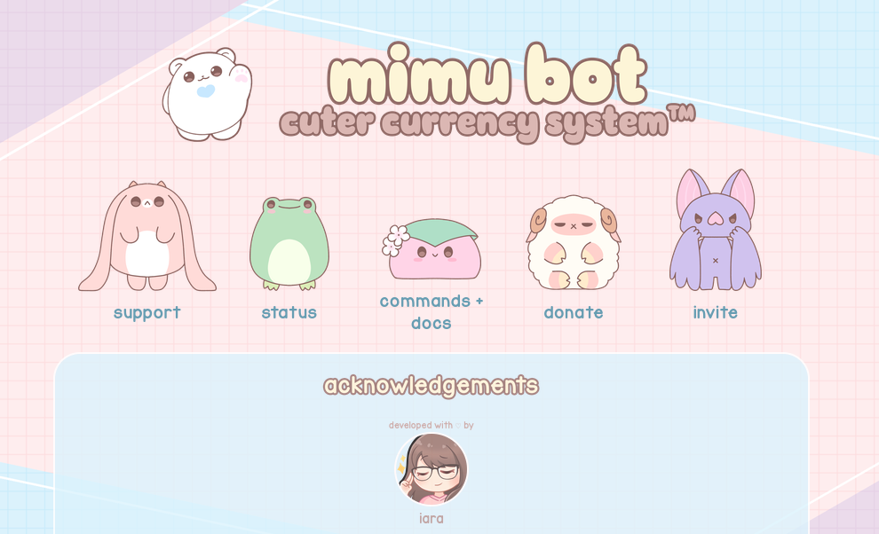

<!-- P2 -->
## Where in the hell am I?
*Fixed on: ??/10/2026*

[Website](https://discord.com) | [Discord](https://discord.gg/discord-townhall)

> Of all the vulnerabilities in this repository, this is part of the most interesting ones.

If you don't know what is Discord, then I don't know why in the actual hell are you viewing this site lol



As you may know, Discord provides developers ways for users to share data and interact with applications. One of those is modals, which are forms that can only be triggered as a response to another interaction (slash commands, buttons... etc.)



When you submit a modal, this interaction data is sent by the client to `POST /api/v9/interactions`: 

```json - schema.json
{
    "type":5,
    "guild_id":"@type :: integer()",
    "channel_id":"@type :: integer()",
    "data":"@type :: ModalSubmissionData()",
    "nonce":"@type :: integer()"
}
```

As this modal is only triggered as response to an interaction, this should be *bounded* to the metadata of such interaction. Changing `guild_id` to an ID of a foreign guild failed with `400` saying "Unknown Channel", but also pointing the `channel_id` to a channel of the foreign guild fired a `204`, and the `INTERACTION_CREATE` gateway event data received by my bot was the following; Assume that the modal was invoked in the channel $B$ of guild $A$ and there is a target guild $C$ with channel $D$ which the modal submission was redirected to

```jsonc - gateway_interaction.json
{
      "version":1,
      "type":5,
      "token":"@type :: str()",
      "message":{
          "webhook_id": "@type :: integer()",
          "type": 23,
          "tts": false,
          "timestamp": "@type :: integer()",
          "pinned": false,
          "mentions": [],
          "mention_roles": [],
          "interaction_metadata": {
              // ... [snip]
              "channel_id": "B"
          },
          // ... [snip]
      },
      "member":{
            // ... [snip]
            "roles":"Roles(C)",
            "permissions":"Perms(A)"
      },
      "guild_id":"C",
      "guild":"GuildData(C)",
      "channel_id":"B",
      "channel":"ChannelObject(B)"
      // ... [snip]
}
```

The interaction is saying that I submitted the modal in the channel $B$ inside of the guild $C$ and that the permissions I have on $C$ are the ones on $A$... what?

So, this means that any bot that retrieves data entirely from interactions to make operations or decisions may think that there is a channel $B$ on $C$ and will think that I have permissions that I don't have on $C$. If I'm the owner of $A$, Discord will just send `18014398509481983` which is every permission bit set.

> Obviously, you must be a member of the target guild, otherwise Discord's backend wouldn't be able to resolve your member object and thus fail with "Unknown guild".

Being myself, I don't want to stop there. I actually want to see a bot where I can exploit this and be able to cause harm, and I took a look at one bot that I used several times before called Mimu.

#### A cute and aesthetic raid

[Mimu](https://mimu.bot) is a bot which is pretty similar to scriptable bots like Atlas, but this one is more simple and it also has a global economy/minigame system. At the date of this finding it sat in 4M servers.



The bot provides basic functions like a welcoming system, auto responses and it allows customizing messages using variables and functions. Watching how the bot handles modals, I noticed that when you submit the edit auto response content modal the submission data is as follows:

```json modal_data.json
{
  "id":"@type :: integer()",
  "custom_id":"arEditModal help me",
  "components":[
    {
      "type":1,
      "components":[
        {
          "type":4,
          "custom_id":"arReplyInput",
          "value":"@type :: str()"
        }
      ]
    }
  ]
}
```

The `custom_id` seems just like a plain command for the bot to identify which auto response to change by its literal name and the rest is taken from the own submission payload. As I can change the destination of this submission and permission checks doesn't matter (depending on the library, you'll see at the end), just creating an auto response with the same trigger on my private server and doing the trick will give me the ability to change it on the target server.

These auto responses also allow using Mimu functions like `{addrole:}`, `{removerole:}` or `{setnick:}`. If you want to play with the economy system of the bot, you can also use `{modifybal:}` and `{modifyinv:}`.

https://github.com/user-attachments/assets/f9e0d2a0-022c-4c14-a1b3-7fd2a5eb3da0

You can do the same for button responders and embeds by just knowing their internal names in the target server (the button responder's names are also pretty easy to get, as they are in the `custom_id` of the button).

I also tested other bots besides this one, and one [Reaction Roles bot](https://reactionroles.app/) had an entrypoint. The `/customize-bot bio` slash command which allows you to change the bot bio in your server prompted a modal whose submission data is this:

```json modal_data.json
{
  "id":"@type :: integer()",
  "custom_id":"1:customize-bot-bio",
  "components":[
    {
      "type":18,
      "components":[
        {
          "type":4,
          "custom_id":"bio",
          "value":"uwu owo"
        }
      ]
    }
  ]
}
```

Again, doing the trick will allow you to change this bot bio on any target server.

A good thing I need to point out is that discord.js bots were protected from the permission issue, as the library only reconstructs the member permissions from the roles that they have on the server. So if the bot was checking permissions, it would just say that you don't have permissions.

The team probably took less than a week to fix it, don't know exactly when was fixed because they didn't say anything.

> I'll put here a link to the disclosure report once Bugcrowd fixes his webpage, because there's an open issue with disclosure approvals.
