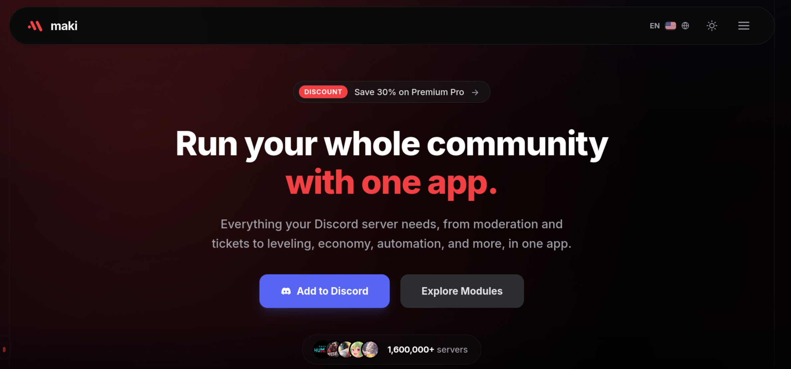
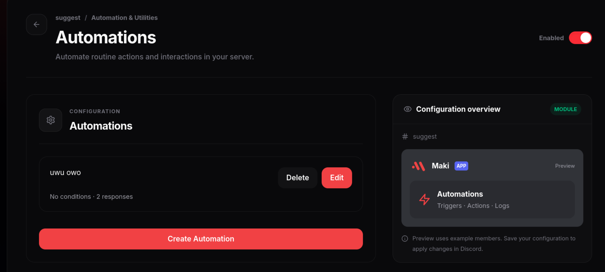

<!-- P3 -->
## Transmiting my guild activity in your channels
*Fixed on: 28/10/2026*

[Website](https://maki.gg) | [Discord](https://maki.gg/support)

It's a multi-purpose bot owned by Quare CommV. Has various functions just like Dyno and Sapphire and also an [API](https://api.maki.gg/docs), so other developers can interact with the bot.



There's a module called automations which lets you configure the bot to make things when certain Discord action is made (like sending a message, adding reactions or boosting the server) and some conditions are meet:



One of the action that the bot can do is sending a CV2 message to a specific channel. The schema of that action in requests is the following:

```json
{
    "type":"SEND_MESSAGE",
    "components":"Array<? extends DiscordV2Component>",
    "channel_id":"<Snowflake>"
}
```

The backend allowed me to put in `channel_id` a channel of a foreign guild. As it's triggered on Discord and not by a dashboard request I expected it to not work... but it did:

https://github.com/user-attachments/assets/68fa6910-8d61-409e-8c1f-4fe331966f62

With it, I can just create an action that it's triggered on every new message on my guild without any conditions and start spamming messages on it. It seems that the message was not able to ping `@everyone` if the bot had the default permissions, but it did allow using components like link buttons, thumbnails, containers and image galleries. You could send pretty naughty stuff as the bot.

The dev fixed it quickly.
