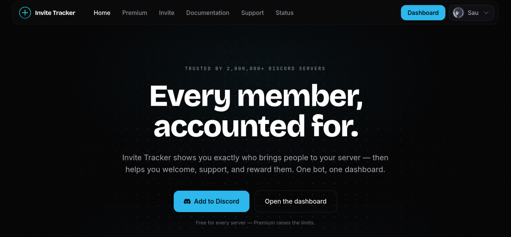
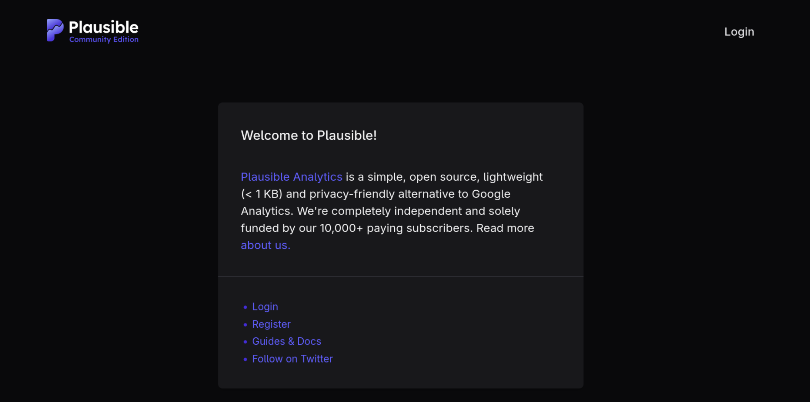

<!-- P2 -->
## Tracking your usage
*Fixed on: 27/10/2026*

[Website](https://invite-tracker.com) | [Discord](https://support.invite-tracker.com)

This bot is very well known around Discord. It's mainly for invite management, but now it's starting to convert into a multi-purpose bot with functions like anti raid, tickets, and welcome/leave/boosts messages.

By watching the frontend HTML, I noticed that there's a subdomain that receives analytics from the main bot website, which is `https://plausible.riks.gg`. It hosts a Plausible CE instance.

Looking at this analytics software, I noticed an advisory that points to a vulnerability in a dependency called [phoenix_storybook](https://github.com/phenixdigital/phoenix_storybook). Specifically, `CVE-2026-8467` says:

> **Unauthenticated remote code execution via HEEx template injection in phoenix_storybook playground**
>  
> An unsafe HEEx template generation vulnerability allows any unauthenticated user to execute arbitrary code on the server. The phoenix_storybook playground accepts user-controlled attribute values over WebSocket and interpolates them unsanitized into a HEEx template that is subsequently compiled and evaluated with full Elixir `Kernel` access.

The Plausible advisory points to the `/storybook` endpoint which was removed as an additional safety measure. This instance still had it.

Reading the [Noctaly case](noctaly.md) should give you the needed information to understand and exploit this, but in summary, you can send a WebSocket message that injects Elixir code into an expression eval, thus granting you unauthenticated RCE.

At first instance, a simple payload (`System.cmd("id",[])`) triggered the WAF and blocked the message, but as Elixir is lenient with spaces on syntax (this is a valid call: `File           .       read()`), I just added a few spaces and the request flowed without problems: it executed the injected code successfully (I sent to my box a http request with the running user info):

https://github.com/user-attachments/assets/0979afdc-3f7d-412d-8442-de960efcaf50

> I had some problems setting up OBS, so the video quality may seem low. Sorry for that  

Luckily, compared to Noctaly, this one was limited, as it was only receiving metadata from the main website. The rest was apparently isolated from Invite Tracker.

Still, the metadata included browser user agents, IPs, ticket transcript URLs and guild IDs. There were also OAuth2 codes with their state as they were introduced in a query string of a page which then requests the API for the code exchange. Winning the short race against that API request could result in an account takeover.

The dev fixed it real quick.