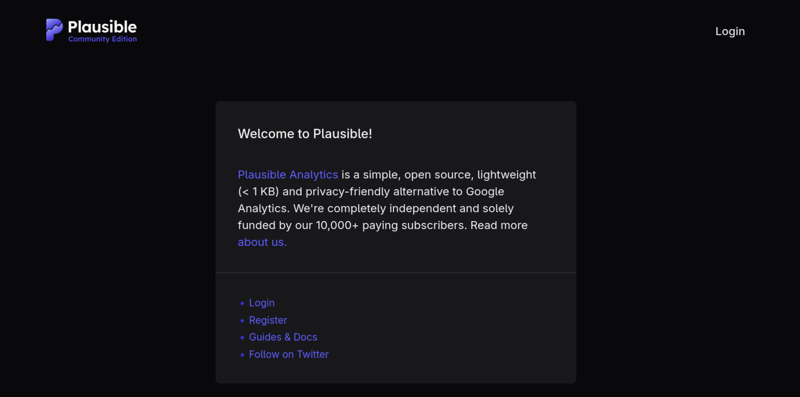

<!-- P1 -->
## Update trolling
*Fixed on: 28/10/2026*

[Website](https://maki.gg) | [Discord](https://maki.gg/support)

It's a multi-purpose bot owned by Quare CommV. Has various functions just like Dyno and Sapphire and also an [API](https://api.maki.gg/docs), so other developers can interact with the bot.


Looking at the frontend HTML, I noticed that a script is loaded from the subdomain `analytics.maki.gg`:

```html
<script src="https://analytics.maki.gg/js/pa-48qbc5RLJ7_b01WrAdoVr.js" id="plausible-script" data-nscript="afterInteractive"></script>
```

As the attributes says, it hosts a Plausible CE instance:



Looking at this analytics software, I noticed an advisory from months ago that points to a vulnerability in a dependency called [phoenix_storybook](https://github.com/phenixdigital/phoenix_storybook). Specifically, `CVE-2026-8467` says:

> **Unauthenticated remote code execution via HEEx template injection in phoenix_storybook playground**
>  
> An unsafe HEEx template generation vulnerability allows any unauthenticated user to execute arbitrary code on the server. The phoenix_storybook playground accepts user-controlled attribute values over WebSocket and interpolates them unsanitized into a HEEx template that is subsequently compiled and evaluated with full Elixir `Kernel` access.

The Plausible advisory points to the `/storybook` endpoint which was removed as an additional safety measure. This analytics instance still had the endpoint.

And welp, just as [Noctaly](noctaly.md), exploitation was pretty straightforward and the impact is pretty much the same:

https://github.com/user-attachments/assets/0977b8c1-b3f2-4444-9b7a-c324680d7a0b

> I had some problems setting up OBS, so the video quality may seem low. Sorry for that

The dev said that they updated the instance when the CVE came out, but for some reason it was still in a vulnerable version. What probably happened here is that some sort of cache thing happened and the container image was just upgraded to the latest version before the patch. Anyways, he fixed it real quick.

