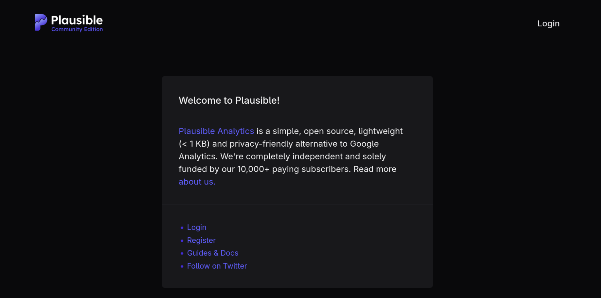
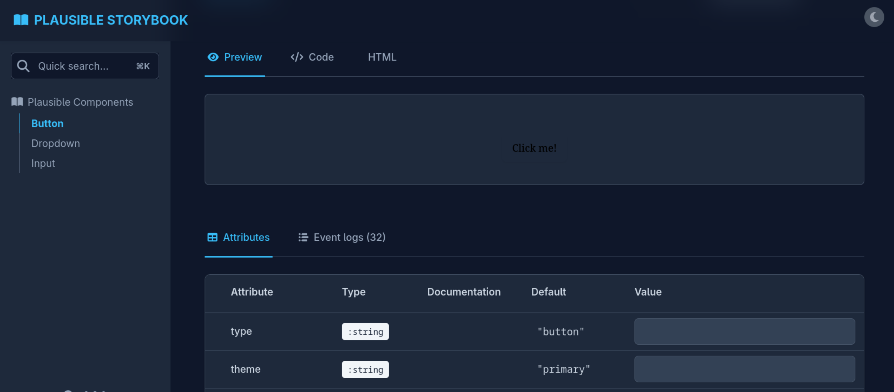

<!-- P1 -->
## Silently viewing and changing your users actions
*Fixed on: 26/10/2026*

[Website](https://noctaly.com) | [Discord](https://noctaly.com/support)

Noctaly is a multi-purpose Discord bot which is a bit popular. Seems that some big Discord servers use it.


Peeking at subdomains, I noticed that the main website was collecting usage analytics at the subdomain `https://s.noctaly.com`, which uses Plausible CE:



Looking at this analytics software, I noticed an advisory from months ago that points to a vulnerability in a dependency called [phoenix_storybook](https://github.com/phenixdigital/phoenix_storybook). Specifically, `CVE-2026-8467` says:

> **Unauthenticated remote code execution via HEEx template injection in phoenix_storybook playground**
>  
> An unsafe HEEx template generation vulnerability allows any unauthenticated user to execute arbitrary code on the server. The phoenix_storybook playground accepts user-controlled attribute values over WebSocket and interpolates them unsanitized into a HEEx template that is subsequently compiled and evaluated with full Elixir `Kernel` access.

The Plausible advisory points to the `/storybook` endpoint which was removed as an additional safety measure. The Noctaly instance still had it:



So indeed, it's vulnerable. The advisory points to a WebSocket event called `psb-assign`, from which the server was processing one of its name/val args using this:

```elixir
{name, val} when is_binary(val) ->
  ~s|#{name}="#{val}"|
```

and then, evaluating the expression without sanitation, sandbox or anything else. The advisory doesn't point to straightforward steps to exploit this even in the own `phoenix_storybook`, and there are no public PoCs of this vulnerability, so I must craft a PoC. Given that we are in the AI/LLM era, this is easier than years ago.

The `psb-assign` WebSocket event looks like this:

```json
[
  null,
  null,
  "lv:[component_id]",
  "event",
  {
    "type":"event",
    "event":"psb-assign",
    "value":{
      "variation_id":"@type :: string()",
      "[storybook_key]":"@type :: string()"
    }
  }
]
```

This event is sent to assign a variable value in the current Storybook's component (A Storybook is just a playground to edit a HTML element, which is the component). In the Plausible page, we can see that we have three components (button, dropdown and input). The original exploitation in a stock `phoenix_storybook` instance required just joining to a preview session and sending this payload with a valid component's variation ID and one of its variables as key (can be `type`, `theme`, `class`, `label`... etc), but on Plausible we also require knowing the live preview element ID as it doesn't use a global `iframe` to render the preview, which in this case, for buttons is `plausible_web_storybook_button-playground-preview`. So after loading the button preview page and sending this WebSocket message:

```json
[
  null,
  null,
  "lv:plausible_web_storybook_button-playground-preview",
  "event",
  {
    "type":"event",
    "event":"psb-assign",
    "value":{
      "variation_id":"default",
      "class":"x\" t={<Elixir code here>} y=\""
    }
  }
]
```

The instance executed the injected code successfully (I sent to my box a http request with the system version banner):

https://github.com/user-attachments/assets/ba7ae238-4904-4071-8918-591e141203c0

> I had some problems setting up OBS, so the video quality may seem low. Sorry for that  

As this seems the main analytics receiver of the bot infrastructure, you can sniff the analytics data sent by the bot's dashboard users and other things to this instance. The website was also loading JS assets from there, so that's a big vector for XSS site-wide. I also found stuff that can be used for lateral movement.

```html
<!-- This line of code was on noctaly.com, to be exact -->
<script src="https://s.noctaly.com/js/script.tagged-events.js" data-domain="noctaly.com" defer="" data-nscript="afterInteractive"></script>
```

The dev fixed it real quick.

> **Fun fact:** The [Double Counter breach](https://doublecounter.gg/blog/security-incident-october-2026) happened because an old Metabase instance (another analytics tool) had an unpatched vulnerability which gave the actors admin privileges. On that same instance, they found valid credentials to SSH into the box, and the box also had valid credentials for the entire cloud infrastructure. The initial foothold is similar to this case.