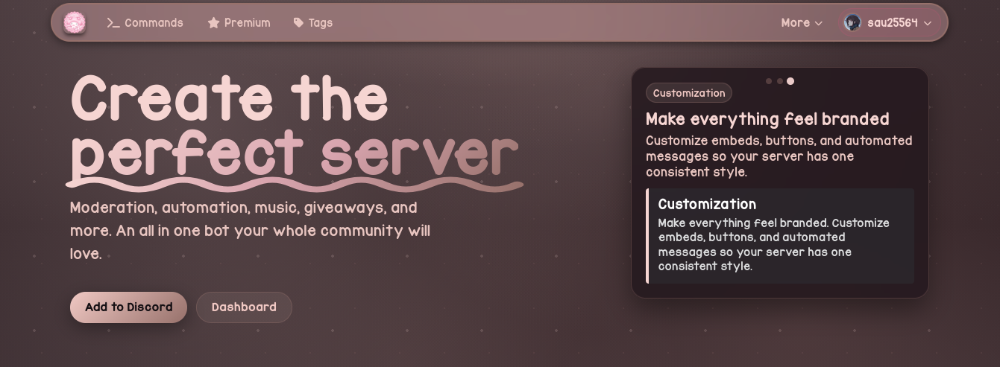
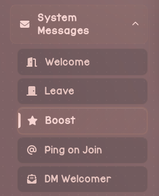
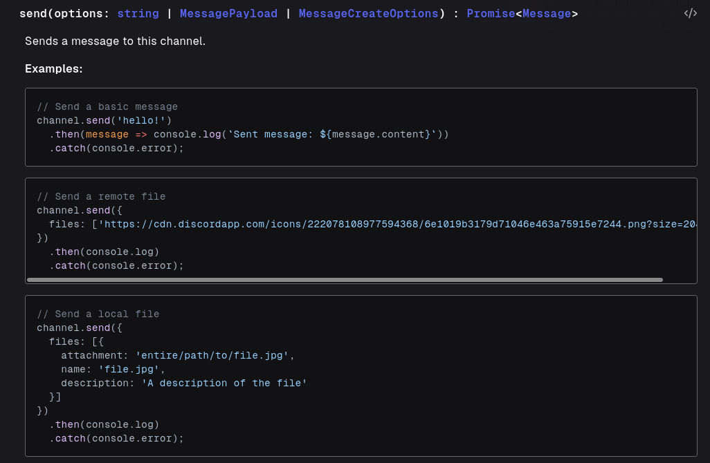

## Surely this is safe
*Fixed on: 04/10/2026*

[Website](https://dolls.gg) | [Discord](https://discord.gg/dolls)

This is a small multipurpose bot whose main theme is [My Melody](https://hellokitty.fandom.com/wiki/My_Melody). It has a few modules like AntiNuke, Giveaways, Auto responders/reactions, Embeds and other stuff.



The bot offers a message system that you can configure to send messages on events like Member Join/Leave (either in a guild channel or DM) and server boost:



On most events, to save a template a `POST` is sent to `https://api.dolls.gg/api/dashboard/guild/:guild_id/[boost|welcome|leave]/[id]` with this:

```json
{
    "channelId":"<Snowflake>",
    "messageData":{
        "content":"<String>",
        "embeds":"Array<DiscordEmbed>",
        "reactions":"<?>"
    }
}
```

On the welcome, leave, boost and DM Welcomer systems the server allowed to append any attribute to the `messageData` that is not `components`. This would mean that we can append other fields that the Message Create endpoint accepts as this object is possibly being forwarded to the endpoint. For a sanity check I'll try to set `flags = 32768`, which is the `IS_COMPONENTS_V2` flag because the bot would fail to send a message with a content and/or embed and that flag set as Discord doesn't allow that, and thus allowing me to see if the injection was sucessful.

With the leave and welcome (guild and DM) system didn't work, but on boosts, when I tested the message the server said:

```http
HTTP/1.1 500 Internal Server Error
Content-Type: application/json; charset=utf-8
Access-Control-Allow-Credentials: true
Access-Control-Allow-Origin: https://dolls.gg
Server: Cloudflare

{"message":"Failed to test message"}
```

The injection was probably successful... so I tought a bit beyond and after noticing that the bot is made on discord.js, I went to they docs and I saw that the `BaseGuildTextChannel#send` method (the main method to send messages) accepts an attribute called `files`:



If the bot is sending the message as `channel.send(messageData)`, that would mean that I have the ability to send through the bot any file that is inside of the host where it's hosted. I tested it by sending myself the `/etc/passwd`... and it worked, and so for the main `package.json` file:

https://github.com/user-attachments/assets/356d4e47-f22f-4d3a-8f0f-0b1a9cf54dda

The source code and other stuff (including the bot token) could be extracted with this. Didn't want to go that far because that implies making the bot upload all of that sensitive stuff into the Discord CDN.

> A funny thing is that, as you see on the discord.js docs, it also allows putting URLs which the library will fetch and append the response as attachment. It's a gadget almost equivalent to `file_get_contents` in PHP.

The dev fixed it quickly.


