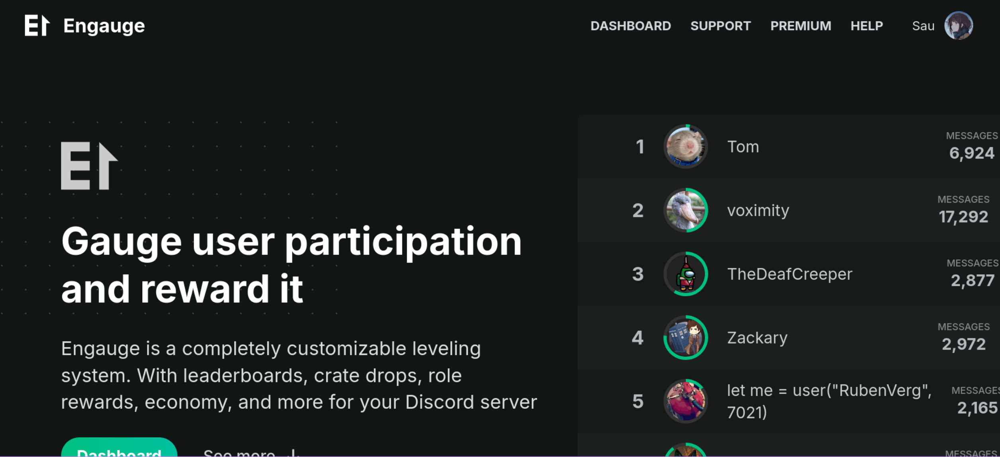
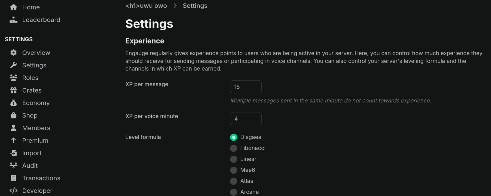
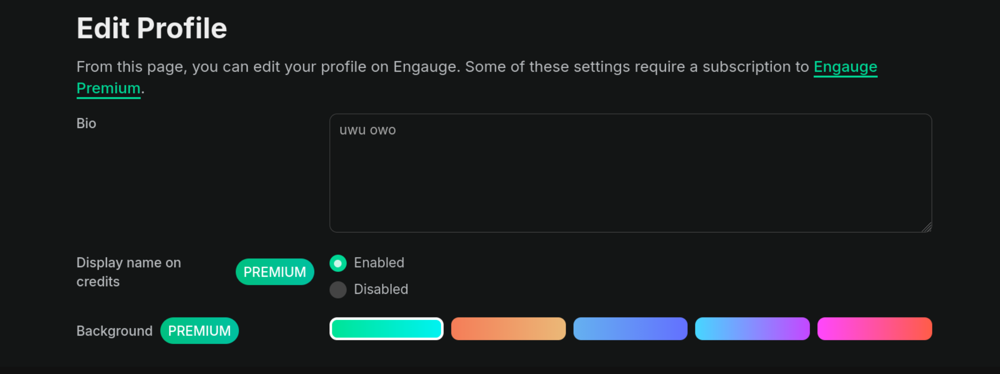
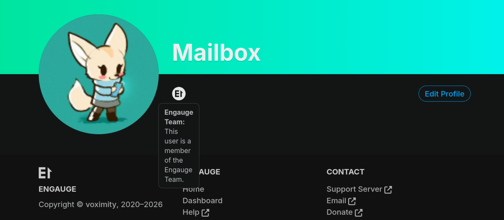

<!-- P1 -->
## Every path must start with "/", but only if it's absolute.
*Fixed on: 22/10/2026*

[Website](https://engau.ge) | [Discord](https://engau.ge/support)

This is a not-so popular leveling Discord bot. It just goes around that and also allows importing levels from other bots like MEE6, Lurkr and Atlas.



The dashboard allows configuring several stuff from the bot:



When you save something, every change is sent as an operation to apply to a json object field, which in the request is represented as an absolute path. This is sent to `PATCH /api/v1/servers/{guild.id}` if you edit a setting (for example, the level up message):

```json
[
    {
        "op":"add",
        "path":"/levelMessage",
        "value":"<System.String>"
    }
]
```

The endpoint answers with the modified object:

```jsonc
{
    "id":"<System.Integer>",
    "name":"<System.String>",
    "icon":"<System.String>",
    // ... [snip]
    "premiumServer":null,
    "audits":"<Engage.AuditEntry>",
    "crates":[],
    "members":[],
    "roles":[],
    "shops":[],
    "transactions":[],
    "jobs":[]
}
```

The `/aboutText` can only be edited if you have premium. Trying to edit it results in:

```http
HTTP/1.1 401 Unauthorized
Date: Thu, 22 Oct 2026 19:10:59 GMT
Content-Type: application/json; charset=utf-8
Server: cloudflare
Access-Control-Allow-Credentials: true
Access-Control-Allow-Origin: https://engau.ge

{"error":"About text requires Premium"}
```

But setting `path` to a relative path like just `aboutText`, now resulted in a `200 OK` and the attribute was edited.

So, it seems that the backend was just trying to validate the attribute by the absolute path but it didn't account for literal attributes/relative paths. The config `id` attribute represents the guild id to which the config belongs but that isn't editable because there was some primary key constraint on it, making the server throw `500 Internal Server Error`.

I also saw that the website lets you edit some specific things of your profile, like your bio and (if you have premium) display name styles:



When you save your bio, this sends a `PATCH` to `/api/v1/users/@me` with the same body of the above endpoint, just with the attributes of the user now:

```json
[
    {
        "op":"add",
        "path":"/bio",
        "value":"<System.String>"
    }
]
```

This answers with this:

```json
{
    "id":"<System.Integer>",
    "votes":"<System.Integer>",
    "earlyVotes":"<System.Integer>",
    "avatar":"<System.String>",
    "name":"<System.String>",
    "bio":"<System.String>",
    "donator":"<System.Boolean>",
    "premiumStart":"<?>",
    "premiumEnd":"<?>",
    "premiumCharged":"<?>",
    "premiumServers":"<System.Integer>",
    "premiumCredits":"<System.Boolean>",
    "backgroundIndex":"<System.Integer>",
    "premiumOverride":"<System.Boolean>",
    "admin":null,
    "patreonConnection":null,
    "kbs":"System.Array<?>",
    "premiumServersNavigation":"System.Array<?>"
}
```

Trying to set `votes` and `donator` works, giving me the ability to give myself arbitrary votes and change my rank to donator. But the most relevant thing here is the `admin` field. At the first attempt the server threw a `500 Internal Server Error`, but as is `null` and not `false` as other fields I tought that this field is actually an object. Setting it to `{}` now gave a `200 OK` with this data:

```json
{
    "admin":{
        "id":"<System.Integer>",
        "kb":false,
        "serverSettings":false,
        "blog":false,
        "user":null
    }
}
```

That's the actual object, by the fields we can see that these are the allowed privileges. `kb` is for editing the knowledge base of the page, `blog` is for creating posts in the blog and `serverSettings` is for allowing changing any server settings regardless of your permissions. The problem now is that after populating the field it won't be editable anymore because the server will now throw an error at any add/replace attempt, but that is solved by just using another account and setting the fields that you just saw.

That gave me the ability to modify the settings of any server and also creating posts/help articles. The website also gave me a badge on my profile to identify that I was part of the Engauge admin team, because I had perms:



The dev fixed it real quick.