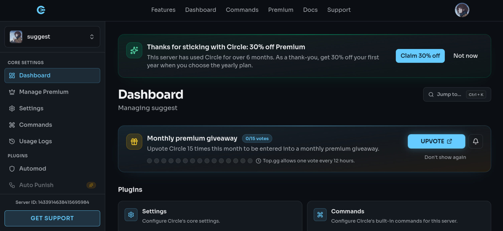
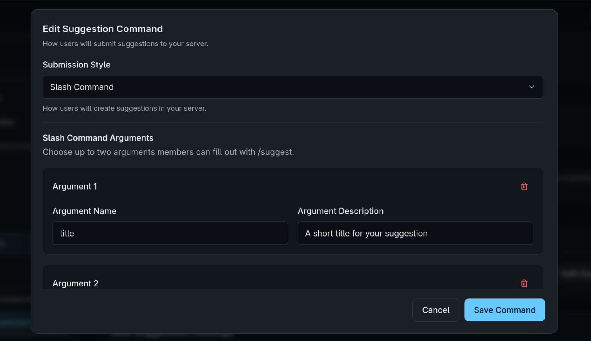

<!-- P3 -->
## The "suggest" server seems like a fun trend
*Fixed on: 19/10/2026*

[Website](https://circlebot.xyz) | [Discord](https://circlebot.xyz/support)

Circle is a multipurpose bot, much like the others in this site. It has modules like custom commands, ban appeal handling, reaction roles, Roblox link... etc.



There's a module for handling suggestions. To submit one, a user must use the `/suggest` slash command, which is created when you enable and configure the module, meaning that it's a guild-scoped slash command:



When you save the config of the module itself, the tRPC method `suggestions.update` is called with this body:

```jsonc
{
    "actions":"Array<ButtonActionHandler>",
    "addTags":"Array<Snowflake>",
    "board":"<?>",
    "buttons":"Array<CircleButtonStyle>",
    "channel":"<Snowflake>",
    "commandID":"<Snowflake>",
    "enabled":"<Boolean>",
    // ... [snip]
}
```

The `commandID` initially was null, and this method allowed me to change it, even to non snowflakeish values. After setting the field, the dashboard would give me options to configure the slash command (you can see the menu in the image above). When updating the command, the `suggestions.updateCommand` method is invoked with this body:

```jsonc
{
    "commandArguments":"Array<DiscordSlashCommandOptions>",
    "inputMode":"command",
    // ... [snip]
}
```

Given that it's updating a slash command on Discord and I can set the commandID — presumably the command being targeted — to any string value, I started to search the Discord API docs for endpoints that serve for this purpose, and I found this one:

> **Edit Guild Application Command**
>  
> `PATCH` /applications/{application.id}/guilds/{guild.id}/commands/{command.id}
>  
> (All parameters for this endpoint are optional)
>  
> Edit a guild command. Updates for guild commands will be available immediately. Returns 200 and an application command object. All fields are optional, but any fields provided will entirely overwrite the existing values of those fields.

So the body that Circle must be sending to this endpoint is:

```jsonc
{
    "name":"suggest",
    "description":"Submit a suggestion.",
    "options":"<TheSuggestCommandOptions>",
    "type":0
}
```

Given that Discord endpoints ignore fields that don't correspond to the expected schema & almost every field on a `PATCH` endpoint is optional, I can try to redirect this request to change a server name/description to `suggest`/`Submit a suggestion`. I entered `../../../../../guilds/{guild.id}` as `commandID` and when I ran `suggestions.updateCommand`, the target server name and description were changed.

https://github.com/user-attachments/assets/5f397fb0-1bf2-43f1-985b-33ab1921fd35

Redirecting to channels didn't work, because the `type: 0` in the body was making Discord throw a 400 (invalid channel type), but you can redirect this request to any endpoint that also accepts those fields, which would allow you to do things like rewriting the global and guild-scoped slash commands of this bot to `/suggest <your provided command options>`.

The dev fixed it quickly.