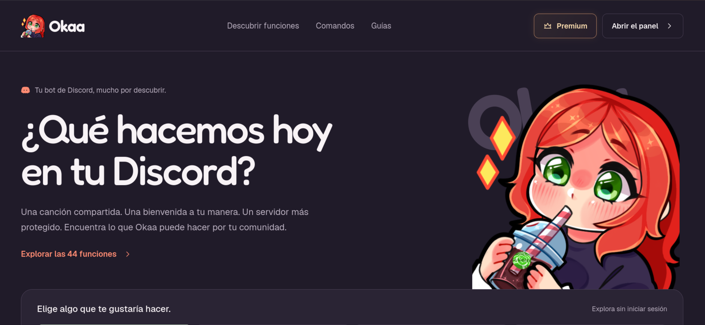
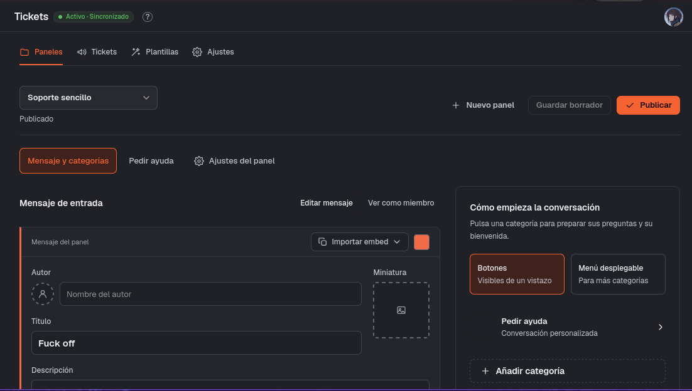
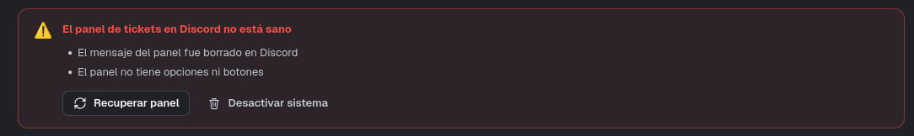

<!-- P2 -->
## Recovering your panel... (Will delete everything)
*Fixed on: 13/10/2026*

[Website](https://okaa.app) | [Discord](https://discord.gg/okaa)

Okaa is a small hispanic multi purpose bot that has several functions just like other bots. It has a nice dashboard.



There's a module for tickets that works with panels, just as most ticket bots around there:



On the settings (Ajustes), we can configure some global settings for the tickets like the transcripts channels. When you save it, a `PUT` is sent to `/guilds/:guild_id/tickets` with the following body:

```json
{
    "TransCh":"<Snowflake>"
}
```

The endpoint answers with this:

```http
HTTP/1.1 200 OK
Content-Type: application/json; charset=utf-8
Server: cloudflare

{
    "_id":"<ObjectId>",
    "Guild":"<Snowflake>",
    "Message":"<Snowflake>|vacio",
    "RolesStaff":"Array<Snowflake>",
    "UsersWithTicket":"Array<Snowflake>",
    "buttons":"<?>",
    "defaultPanelId":"<ObjectId>",
    "Channel":"<Snowflake>",
    "TransCh":"<Snowflake>"
    # ... [snip]
}
```

As this is a `PUT` request I tought, can I change other things? I tried to change the `Channel` field and... it worked. But, what is this field for?

When I changed it to an invalid channel, this message popped up:



> On english: The ticket panel is not healthy; the message was deleted & there's no options.

The `Recuperar` (Recover) button sends a request to `POST /guilds/:guild_id/tickets/recover`. By watching how it behaves I noticed that if `Message` is not null, it will try to delete the message with that ID on the channel `Channel` and then post the ticket panel message on the said channel. When setting a channel ID from another server the Recover function sent the ticket panel message there without any questions.

The field was also not type validated, and the `DELETE` request to delete the message was constructed as this:

`/channels/${Channel}/messages/${Message}`

So setting `Channel` to `{channel.id}#` will cancel the leading path and make the bot to delete a channel. Using dot segments we can also control the final request path and practically do any `DELETE` Discord bot action that is allowed and the bot has permissions to do:

https://github.com/user-attachments/assets/5a913fe6-9557-4a76-ae57-0d3f007bcd9a

The dev took a while to fix it.

