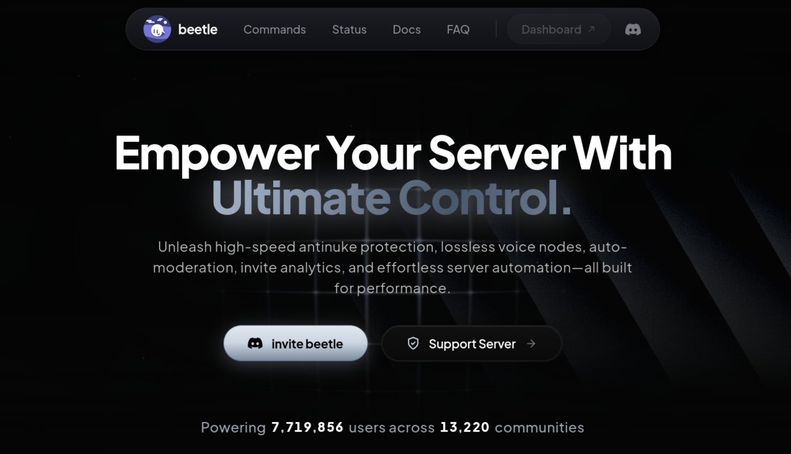
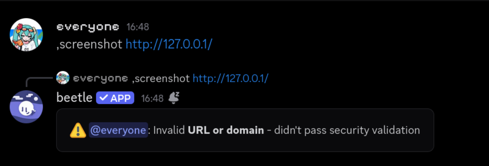
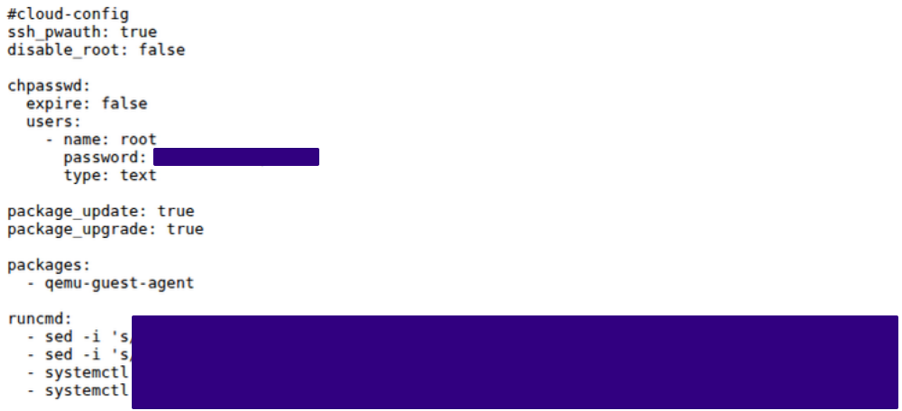
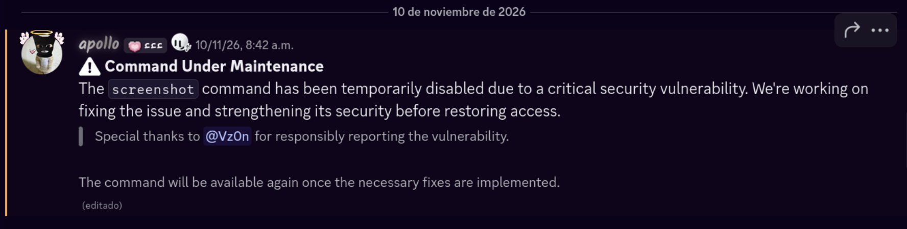

<!-- P1 -->
## Damn Chromium
*Fixed on: 17/11/2026*

[Website](https://beetle.lat) | [Discord](https://discord.gg/beetle)

It's a small multi-purpose bot that's like bleed or NotSoBot, but it's more focused on moderation and security.



Recently, they added a command for capturing screenshots from websites (`,screenshot`), which essentially lets you view webpages from Discord. This launches a headless browser and takes a picture of the tab.

Trying to send requests to `http://127.0.0.1` or `http://169.254.169.254` made the bot say:



But then I tought: this is using a headless browser so, if the bot is just checking the input and Chromium handles the rest... that would mean we can simply send a redirect to the browser and bypass this. And indeed, that worked.

> The input check was also a bit flawed, because other loopback addresses (like 127.44.254.1) were also bypassing it.

While trying to point to internal addresses, I noticed that when beetle can't access a target, it will fall back to other two third-party services to take a screenshot:

```bash
vzon@vzon:~/oob$ python3 app.py 
agent: [Beetle User-Agent]
address: dy.dx.dz.dw
127.0.0.1 - - [09/Nov/2026 18:19:04] "GET /uwuowo?target=http://127.0.0.1:n/ HTTP/1.1" 307 -
agent: Mozilla/5.0 (X11; Linux x86_64) AppleWebKit/537.36 (KHTML, like Gecko) Chrome/121.0.0.0 Safari/537.36
address: ***.***.***.***
127.0.0.1 - - [09/Nov/2026 18:19:06] "GET /uwuowo?target=http://127.0.0.1:n/ HTTP/1.1" 307 -
agent: Mozilla/5.0 (X11; Linux x86_64) AppleWebKit/537.36 (KHTML, like Gecko) HeadlessChrome/156.0.8078.73 Safari/537.36 WP.com mShots
address: ***.***.***.***
127.0.0.1 - - [09/Nov/2026 18:19:09] "GET /uwuowo?target=http://127.0.0.1:n/ HTTP/1.1" 307 -
```

This lets me know which ports are closed/have non HTTP services. And also which addresses are unreachable, as the bot was taking 18~ seconds to reply if it was the case.

The metadata address was also reachable, and it was an AWS instance (since the bot hosting provider was using AWS). `/latest/user-data` had a funny string:



Luckily, the dev changed that initial password to something else, and probably also that default configuration.

https://github.com/user-attachments/assets/dd2ca2f9-420b-4974-a7c5-bc05b837c33b

Didn't seem like something *really* nasty to me (because the meta-data thing didn't have IAM creds), but the dev went as far to make an announcement and disable the command almost instantly.



He took a while to fix it.