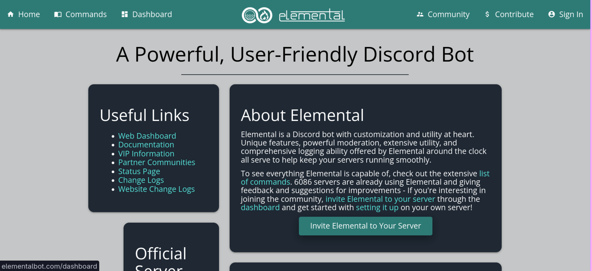
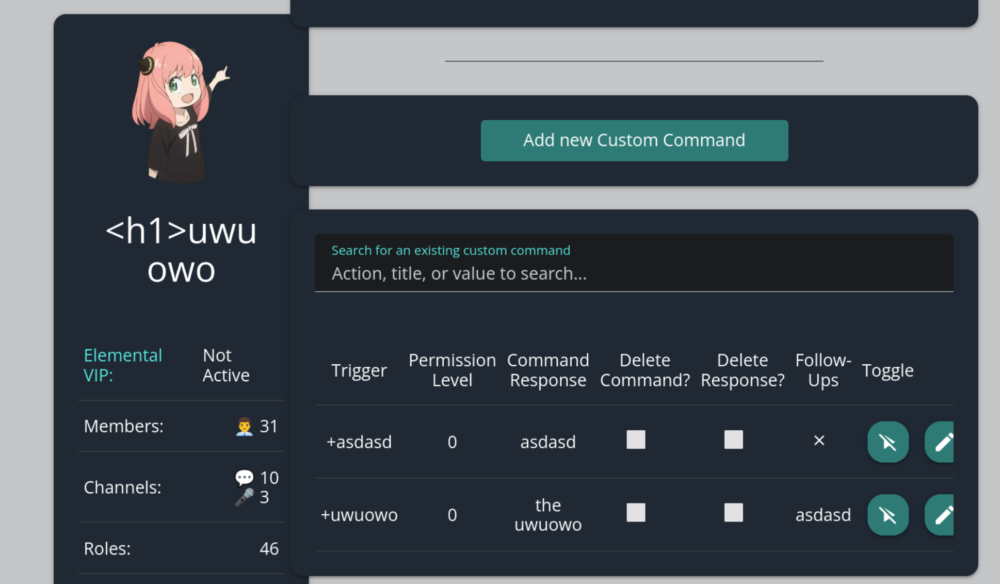
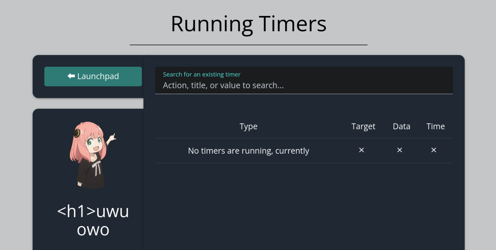
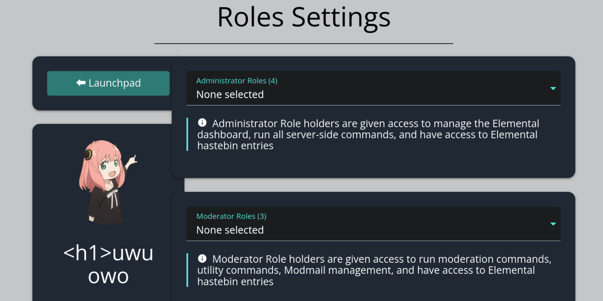

<!-- P4 -->
## Everyone is an admin now. (JavaScript version)
*Fixed on: 21/10/2026*

[Website](https://elementalbot.com) | [Discord](https://elementalbot.com/server)

This is a small bot which is pretty simple and offers basic features like user moderation tools, custom text commands, reaction roles... etc.

On the custom text commands, you can provide a follow up command which will be invoked after the main command executes.

I tried to put a command with a trigger containing a HTML tag and it didn't work, but this same command shown as follow up was getting rendered as part of the site. The typical `` worked.

The bug in that place isn't that interesting, so I started searching other places and I found that there's a triggers module (messages that the bot will send at a specific time), which list in-Discord created timers with their content:

The message content HTML tags was also being rendered as if they were part of the website. Timers can be created by users with the permission level 3 (moderators or helpers), so this is a way to escalate privileges in the dashboard.

Given that this is just a very simple XSS and I never shown weaponization before, I'll do it (only) this time. First, the bot allows you to configure which roles can use the bot and their permissions level:

With the XSS, I can just make an admin set the administrators role to `@everyone` and then, anybody would be able to access the server dashboard. I can, for example, code a script that will iterate every server that the viewing user has access to and make it give admin to everyone and then, I just create a timer with `` as content.

https://github.com/user-attachments/assets/8d5e1df4-8153-4134-92eb-797d651dc0fa

The dev fixed it quickly.